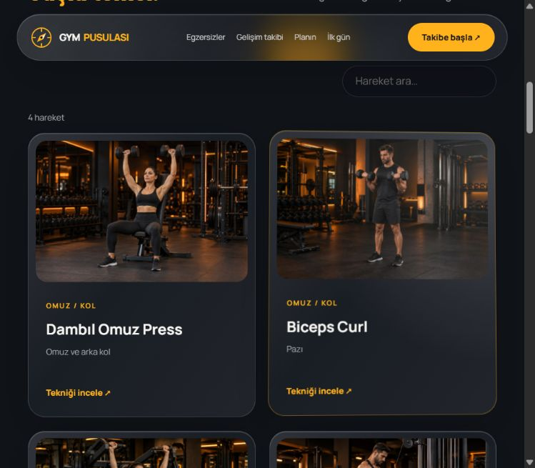
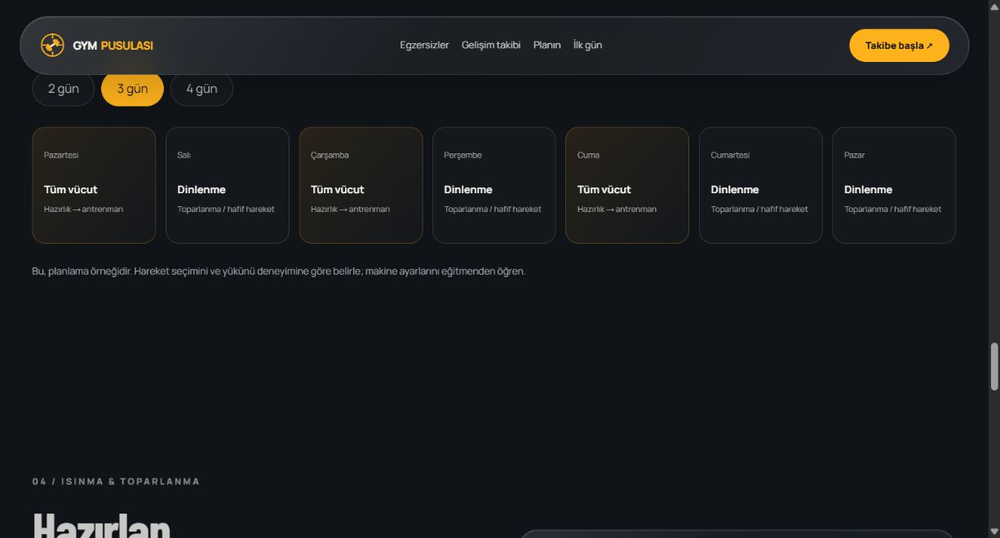

# GYM Pusulası

**Hareketleri keşfet. Antrenmanını planla. Gelişimini takip et.**

GYM Pusulası, Türkçe egzersiz rehberi ve kişisel antrenman araçlarını bir araya getiren Android uygulamasıdır.

[**En güncel test sürümünü indir · v2.3**](https://github.com/Egesagbas/gym-pusulasi/releases/download/v2.3.0/GYM-Pusulasi-v2.3.0-Android-Test.apk) · [Tüm sürümler](https://github.com/Egesagbas/gym-pusulasi/releases) · [Sürüm notları](CHANGELOG.md)

## V2 sürümleri

Her sürüm önceki V2 özelliklerini içerir.

| Sürüm | Bu sürümde eklenenler | İndir |
| --- | --- | --- |
| [v2.3.0](https://github.com/Egesagbas/gym-pusulasi/releases/tag/v2.3.0) | Etkileşimli kas haritası, başarı rozetleri ve açık/koyu/cihaz teması | [APK indir](https://github.com/Egesagbas/gym-pusulasi/releases/download/v2.3.0/GYM-Pusulasi-v2.3.0-Android-Test.apk) |
| [v2.2.0](https://github.com/Egesagbas/gym-pusulasi/releases/tag/v2.2.0) | Türkçe kayıt araması, tarih filtresi, günlük tamamlama listesi ve not defteri | [APK indir](https://github.com/Egesagbas/gym-pusulasi/releases/download/v2.2.0/GYM-Pusulasi-v2.2.0-Android-Test.apk) |
| [v2.1.0](https://github.com/Egesagbas/gym-pusulasi/releases/tag/v2.1.0) | Su günlüğü, haftalık hedef ve kişisel ağırlık rekorları | [APK indir](https://github.com/Egesagbas/gym-pusulasi/releases/download/v2.1.0/GYM-Pusulasi-v2.1.0-Android-Test.apk) |
| [v2.0.0](https://github.com/Egesagbas/gym-pusulasi/releases/tag/v2.0.0) | Dinlenme sayacı, favoriler, kişisel program, gelişim grafiği ve hesap girişi | [APK indir](https://github.com/Egesagbas/gym-pusulasi/releases/download/v2.0.0/GYM-Pusulasi-v2.0.0-Android-Test.apk) |

## Uygulamadan görüntüler

Bu görseller önceki sürümün ekranlarını gösterir.

| Ana ekran | Egzersizler | Haftalık plan |
| --- | --- | --- |
|  |  |  |

## Kurulum

1. Yukarıdaki tablodan APK dosyasını Android telefonuna indir.
2. İndirdiğin dosyayı aç. Gerekirse dosyayı açtığın uygulama için yükleme izni ver.
3. GYM Pusulası'nı aç; hesabını oluştur veya giriş yap.

**Android 7.0 veya üzeri gerekir.** APK'lar test sürümüdür; Google Play dağıtımı ve üretim imzalaması yapılmamıştır. APK derlemeleri tamamlandı; gerçek cihazda görünüm ve giriş akışı uçtan uca ayrıca doğrulanmalıdır.

## Hesaplar ve veriler

- Hesap girişi Supabase ile çalışır.
- Antrenman kayıtları, favoriler, program, su takibi, notlar ve tercihler bu cihazda hesaba göre saklanır.
- Cihazlar arasında otomatik eşitleme yoktur.
- Güncellemeden önce kayıtlarını CSV olarak yedekle. Uygulamayı kaldırmak veya verilerini temizlemek yerel kayıtlarını silebilir.
- Daha eski sürümün üzerine kurulum Android tarafından reddedilebilir. V1 ve V2 imzaları farklıysa yükseltme de reddedilebilir; kaldırmadan önce yedek al.

## Dosya doğrulama

İndirilen APK'nın SHA-256 değeri aşağıdakiyle eşleşmelidir.

| Sürüm | SHA-256 |
| --- | --- |
| v2.0.0 | `84AE277F58778431AB555A9DEB101D6F5E7A1A40C48F0848A668393845535ACB` |
| v2.1.0 | `6A7819B996A327B1C090F89B979FBC3037A035F7FBC6293161433DC4A74829DD` |
| v2.2.0 | `7BB8134209C68A36550D04DB602BF140ED2CDA86703D0A881BCE1824CD3B1882` |
| v2.3.0 | `EB9FAFF60221EDEDB94A968030C34A1D23A461ABBE9CC46537AEC4A90F9C19DA` |

## Önceki sürüm

[v1.0 test sürümü](https://github.com/Egesagbas/gym-pusulasi/releases/tag/v1.0.0) arşivde korunmuştur.

## Proje ve haklar

Bu depo uygulamanın tanıtımını, sürüm notlarını ve test APK'larını içerir. Kaynak kodu bu depoda paylaşılmamıştır.

Geliştirici: **Ege Sağbaş**

© 2026 Ege Sağbaş. Tüm hakları saklıdır. Bu depo kaynak kodu için kullanım lisansı vermez.
